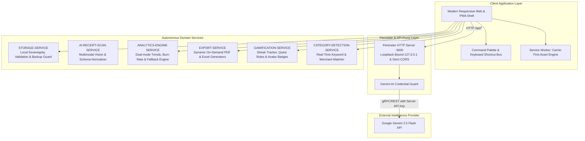

# 💰 AI EXPENSE TRACKING (AI-Enhanced Expense Tracking System)

[](https://reactjs.org/)
[](https://www.typescriptlang.org/)
[](https://vitejs.dev/)
[](https://tailwindcss.com/)
[](https://aistudio.google.com/)
[](https://web.dev/progressive-web-apps/)
[](https://github.com/ASRIVATHSAVAREDDY5588/2420030634-SOA/actions)
[](LICENSE)

An enterprise-grade, **Service-Oriented Architecture (SOA)** personal finance management solution engineered to combine **Local Data Sovereignty** with autonomous **Google Gemini AI** receipt perception and intelligent spending analysis.

Course Project: **2420030634-SOA** | Team: **Batch 16**

---

## 📑 Table of Contents

- [Problem Statement & Financial Impact](#-problem-statement--financial-impact)
- [SOA Architecture & Service Topology](#-soa-architecture--service-topology)
- [Core Safety & Privacy Principles](#-core-safety--privacy-principles)
- [Key Features & Capabilities](#-key-features--capabilities)
- [Quick Start Guide](#-quick-start-guide)
- [REST API Reference Summary](#-rest-api-reference-summary)
- [Automated Testing & Verification](#-automated-testing--verification)
- [Repository Structure](#-repository-structure)
- [Documentation Index](#-documentation-index)
- [License](#-license)

---

## 🚨 Problem Statement & Financial Impact

Modern personal expense trackers typically force users into an unacceptable compromise:
1. **Severe Privacy & Security Risks:** Demanding credentials or continuous OAuth sync to live personal bank accounts.
2. **Cloud Leakage of Personal Transactions:** Uploading intimate daily lifestyle purchases to third-party databases.
3. **Manual Entry Friction:** Requiring tedious typing of merchants, amounts, and dates for every coffee or grocery receipt.

> [!IMPORTANT]
> **AI EXPENSE TRACKING** resolves this compromise through a **Service-Oriented Architecture (SOA)**. Personal financial ledgers remain 100% sovereign within the client's local datastore, while an autonomous perimeter proxy routes optical receipt scanning and grounded budgeting inquiries to **Google Gemini 2.5 Flash** without exposing API credentials or saving transactions silently.

---

## 🏗️ SOA Architecture & Service Topology

The system is decomposed into autonomous, loosely coupled service domains conforming to enterprise SOA design principles:



---

## 🛡️ Core Safety & Privacy Principles

1. **Local Data Sovereignty:** User transactions and account logs are stored strictly inside browser `localStorage`. No cloud database ever receives personal spending records.
2. **Zero Silent Saving Guard:** AI receipt extractions populate the review form for explicit user verification; details are **never silently saved** without confirmation.
3. **Perimeter Credential Protection:** The Google Gemini API key resides solely on the backend server (`.env`). It is never bundled into or accessible by client browser code.
4. **Graceful Fault Tolerance:** If external AI services are unreachable, offline, or rate-limited, the system falls back to an embedded deterministic analyzer (`services/geminiService.ts`) with zero downtime.
5. **Atomic Backup Validation:** Restoring JSON backups validates schemas strictly before replacing state, leaving existing records untouched if validation fails.

---

## ✨ Key Features & Capabilities

### ⚡ Power-User Productivity
- **Command Palette (`Ctrl + K` / `⌘K`):** Universal search and command launcher inspired by Linear and Raycast. Jump to any view, search past transactions, or execute actions instantly without touching the mouse.
- **Smart Category Auto-Detection:** Automatically classifies 100+ merchants as you type (e.g. *Starbucks* → Food, *Uber* → Transport, *Netflix* → Entertainment, *Rent* → Bills).
- **Quick-Add Presets:** Autofocus on modal open, one-tap increment chips (`+₹50`, `+₹100`, `+₹500`, `+₹1000`), and `Ctrl + Enter` instant submission.
- **Universal Bank CSV Importer:** Drag & drop any bank statement CSV or custom spreadsheet; parses columns and imports 50+ transactions in 1 click.
- **Batch Operations:** Multi-select transaction checkboxes with a floating bulk action bar to select all or delete in bulk.

### 🤖 Intelligent AI Assistance (Google Gemini 2.5 Flash)
- **Multimodal Receipt Scanner:** Upload or snap a photo of any receipt; extracts merchant, date, total amount, and category with optical precision.
- **AI Spending Coach:** Returns 3 grounded observations based directly on your recorded transactions. Includes interactive prompt chips (*Where can I cut costs?*, *Analyze Food & Dining*, *Month-End Projection*, *Savings Rate Review*).

### 📊 Financial Command Center & Analytics
- **Safe Daily Spend Allowance:** Dynamically calculates `(Remaining Budget / Days Left in Month)` (e.g. `₹450 / day`).
- **Dual-Mode Interactive Charts:** Toggle between **Cumulative Spending Trend** and **Income vs Outflow Dual Area Chart**.
- **Burn Rate Calculator:** Displays daily burn average, projected 30-day burn rate, and top spending areas.
- **Multi-Account Labels:** Track spending from Cash, Bank Accounts, or Credit Cards (manual labels without bank synchronization).
- **Gamification & Habit Building:** Level progression, daily logging streaks, avatar unlocks, and weekly quest goals.
- **Universal Exports:** Generate and download official **Excel (.xlsx)** spreadsheets and **PDF Statement Reports** on demand.

---

## 🚀 Quick Start Guide

### Prerequisites
- **Node.js 18+** installed ([https://nodejs.org/](https://nodejs.org/))
- *(Optional)* Google Gemini API Key from [Google AI Studio](https://aistudio.google.com/)

### Windows One-Click Quick Launch:
Simply double-click:
```cmd
run-app.cmd
```
*Or via PowerShell:*
```powershell
.\run-app.ps1
```

### Manual Cross-Platform Launch:
```bash
# 1. Clone repository
git clone https://github.com/ASRIVATHSAVAREDDY5588/2420030634-SOA.git
cd 2420030634-SOA

# 2. Configure environment (Optional: add your Gemini API key)
cp .env.example .env

# 3. Install dependencies
npm install

# 4. Build production bundle
npm run build

# 5. Start perimeter server
node server.js
```

Open your browser to: **`http://127.0.0.1:3000`**

---

## 📡 REST API Reference Summary

| Method | Endpoint | Access Level | Description |
| :--- | :--- | :--- | :--- |
| `GET` | `/api/status` | Public / Local | Runtime health check, configured AI model, and API key presence. |
| `POST` | `/api/scan-receipt` | Public / Local | Extracts transaction details from a receipt image (Base64 + MIME). |
| `POST` | `/api/spending-insights` | Public / Local | Returns 3 personalized spending recommendations grounded in transaction logs. |
| `GET` | `/` | Public / Local | Serves the single-page application and offline PWA application shell. |

*For complete request/response schemas, JSON payloads, and error contracts, refer to [docs/API_DOCUMENTATION.md](docs/API_DOCUMENTATION.md).*

---

## 🧪 Automated Testing & Verification

The project includes an automated build verification suite and live REST API contract tests:

### 1. Build & Server Syntax Verification:
```cmd
run-tests.cmd
```
*Or on PowerShell / Linux:*
```powershell
.\run-tests.ps1
```

### 2. Live REST API Automated Verification:
With the server running on `http://127.0.0.1:3000`:
```cmd
test-api.cmd
```
*Or via PowerShell:*
```powershell
.\test-api.ps1
```
*This script automatically verifies:*
1. Service health check (`GET /api/status`)
2. App shell delivery (`GET /`)
3. Spending insights API contract validation (`POST /api/spending-insights`)

---

## 📂 Repository Structure

```
2420030634-SOA/
├── .github/
│   └── workflows/
│       └── ci.yml                     # GitHub Actions CI workflow
├── docs/
│   ├── ARCHITECTURE.md                # SOA microservice design & sequence diagrams
│   ├── API_DOCUMENTATION.md           # Full REST API payload & status code guide
│   └── SOA_VIVA_GUIDE.md              # 1-minute pitch script & viva Q&A
├── components/
│   ├── AddTransactionModal.tsx        # Fast entry modal with quick presets & OCR
│   ├── CommandPalette.tsx             # Universal search & command launcher (Ctrl+K)
│   ├── CsvImportModal.tsx             # Universal bank CSV & spreadsheet importer
│   ├── Icons.tsx                      # Optimized SVG icons dictionary
│   ├── Layout.tsx                     # Responsive app shell & desktop sidebar
│   ├── ShortcutsModal.tsx             # Keyboard shortcuts cheat sheet
│   └── Tour.tsx                       # New user onboarding guided tour
├── server/
│   └── geminiHandler.js               # Encapsulated Gemini AI handler & prompts
├── services/
│   ├── categoryDetector.ts            # Keyword merchant auto-categorization engine
│   ├── exportService.ts               # Dynamic on-demand PDF & Excel export engines
│   ├── geminiService.ts               # Client AI service & local fallback engine
│   └── storageService.ts              # Local datastore, gamification & validation
├── views/
│   ├── Analytics.tsx                  # Dual-mode charts, burn rates & AI chips
│   ├── Dashboard.tsx                  # Overview, balances, budget pace & quests
│   ├── Onboarding.tsx                 # Profile setup & avatar selection
│   ├── Profile.tsx                    # Budgets, accounts, badges, exports & backup
│   └── Transactions.tsx               # Ledger, filters, batch delete & CSV tool
├── public/                            # PWA web manifest, service worker & icons
├── .env.example                       # Environment template (safe placeholder keys)
├── .gitignore                         # Secret protection & build exclusions
├── LICENSE                            # MIT License
├── README.md                          # Repository overview & setup guide
├── package.json                       # Dependencies & scripts
├── run-app.cmd                        # Windows quick-launch batch script
├── run-app.ps1                        # PowerShell quick-launch script
├── run-tests.cmd                      # Windows test suite runner
├── run-tests.ps1                      # PowerShell test suite runner
├── server.js                          # Perimeter loopback server & CORS security
├── test-api.cmd                       # Automated API verification batch script
├── test-api.ps1                       # Automated API verification PowerShell script
└── vite.config.ts                     # Vite build & Workbox PWA configuration
```

---

## 📖 Documentation Index

- 📐 **[docs/ARCHITECTURE.md](docs/ARCHITECTURE.md)** — Architectural design, SOA service decomposition, sequence diagrams, and ER specifications.
- 📡 **[docs/API_DOCUMENTATION.md](docs/API_DOCUMENTATION.md)** — Detailed REST endpoint documentation with request/response schemas and cURL examples.
- 🎓 **[docs/SOA_VIVA_GUIDE.md](docs/SOA_VIVA_GUIDE.md)** — 1-minute elevator pitch script and professor viva evaluation questions with ready-to-deliver answers.

---

## 📄 License

This project is licensed under the MIT License - see the [LICENSE](LICENSE) file for details.
