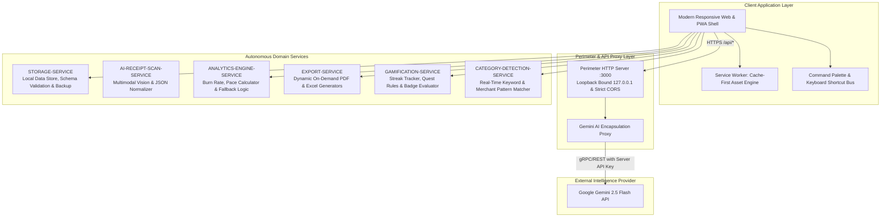
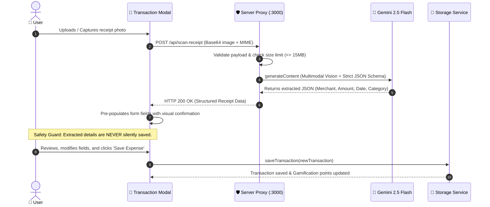
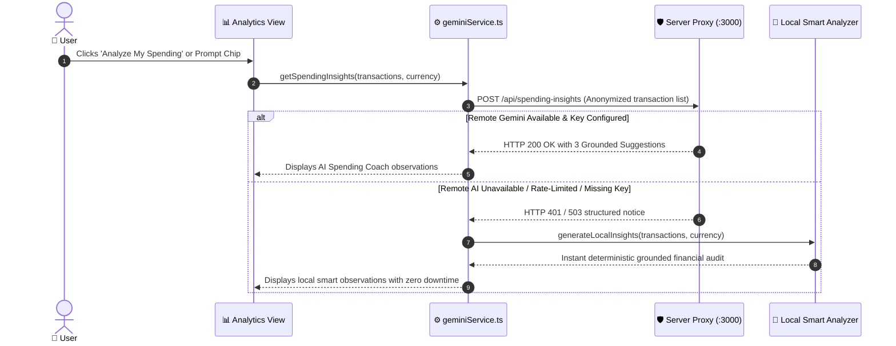
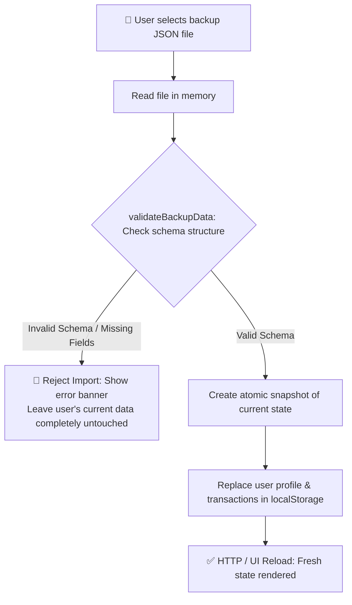
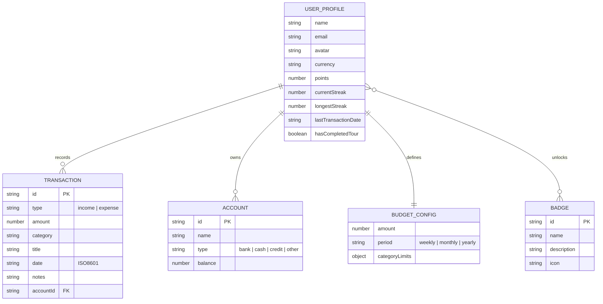

# 💰 System Architecture & SOA Design Document

## 1. Executive Architectural Overview

The **AI EXPENSE TRACKING** application is engineered based on **Service-Oriented Architecture (SOA)** and **Privacy-First Distributed System** patterns. Personal financial management requires zero latency, complete data privacy, high visual responsiveness, and trustworthy intelligent automation.

The system addresses critical challenges in modern consumer finance applications:
1. **Local Data Sovereignty:** Financial logs, bank statements, and personal transactions are stored strictly in the client-side local datastore. No cloud databases or third-party tracking services ever receive personal spending logs.
2. **Perimeter Proxy Isolation:** The Google Gemini API key is encapsulated in a dedicated server-side proxy boundary. The client never handles, bundles, or leaks API credentials.
3. **Graceful Fault Tolerance:** If remote AI services are unreachable, offline, or rate-limited, the system falls back to an embedded local financial analysis engine without service disruption.

---

## 2. Service-Oriented Decomposition

### SOA Principles Implemented:
- **Service Loose Coupling:** The frontend UI is decoupled from the AI processing engine. If the AI proxy endpoint is down, 100% of expense tracking, budget meters, and ledger operations remain functional.
- **Service Abstraction:** The client interacts with uniform contracts (`/api/scan-receipt`, `/api/spending-insights`, `/api/status`) without knowing model parameters or prompt engineering details.
- **Service Autonomy:** Each service (Storage, Analytics, Gamification, Export) owns its business logic and data structures independently.
- **Service Reusability:** The `categoryDetector` and `exportService` can be utilized across CLI, web, or mobile runtimes without modification.

---

## 3. Component Interaction & Sequence Diagrams

### 3.1 AI Receipt Scanning Pipeline (Zero Silent Saving Guard)

---

### 3.2 Spending Insights & Graceful Fallback Choreography

---

### 3.3 Verified Backup & Restore Flow (Safety Guard)

---

## 4. Security Architecture & Boundary Isolation

1. **Loopback IP Binding:**
   - The production server binds exclusively to `127.0.0.1:3000` (loopback) by default, preventing unintended exposure across local area networks.
2. **CORS Perimeter Control:**
   - Strict CORS origin whitelisting (`http://localhost:3000`, `http://127.0.0.1:3000`, `http://localhost:5173`).
3. **Zero Browser Key Exposure:**
   - The Google Gemini API key resides strictly in the root `.env` file on the server.
   - The Vite build configuration never includes API keys in client bundles.
4. **Local Data Sovereignty:**
   - All income, expenses, account balances, and notes persist strictly inside the user's browser `localStorage`.
   - Backup files are exported as verified JSON directly to the user's disk.

---

## 5. Entity Relationship & Data Model Specifications

---

## 6. Progressive Web App (PWA) & Offline Capabilities

- **Service Worker Lifecycle:** Utilizes `vite-plugin-pwa` with Workbox to precache application assets (`index.html`, bundled JS, CSS, fonts, and icons).
- **Navigation Route Strategy:** Fallback to cached `index.html` on network disconnection, ensuring the entire web app works offline.
- **Dynamic Asset Chunking:** Large external dependencies (`xlsx`, `jspdf`, `jspdf-autotable`) are lazily loaded on demand when the user triggers an export, keeping initial bundle load under 200 KB gzipped.
